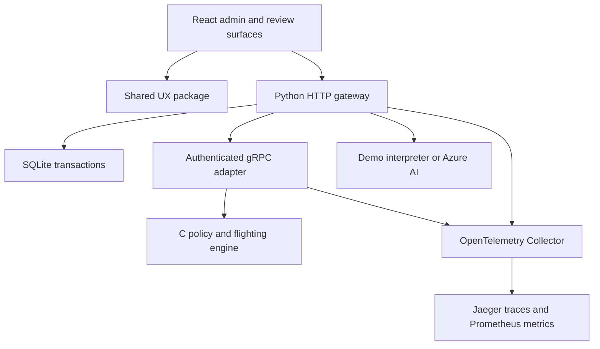

# Architecture

## Runtime topology

The browser has no access to the database, C library, policy token or Azure key. It sends same-origin HTTP requests. The gateway maps authoritative database records to integers in the protobuf schema, then calls the policy service with a two-second deadline. The Python service authenticates metadata and passes a fixed-width C struct to the compiled library.

Only the C engine owns role policy and feature cohort assignment. Python supplies persisted context, authentication and transaction boundaries. The UI represents the result and manages human review. Provider output is treated as untrusted data.

## Proposal lifecycle

1. Authenticate the session and validate the CSRF header and browser Origin.
2. Validate input fields, allowed action/role values and message size.
3. For AI: enforce rollout and rate limit, invoke the provider, validate its schema, and keep the target ID from the user-selected form.
4. Enter an immediate SQLite transaction; read current actor, target and active-admin count.
5. Ask the C engine whether this actor may perform the requested transition.
6. Persist a ten-minute proposal containing actor ownership, target version, action, role, source, rationale and risk; write a proposal audit event.
7. On explicit `confirmed: true`, begin another immediate transaction. Check ownership, pending state, expiry, current actor activity, target version, and the AI kill switch if applicable.
8. Re-evaluate the current authorization policy. Update target and version, revoke target sessions, mark proposal applied, and append before/after audit data in one commit.

The shared library cannot mutate persistence or make network calls. An allowed decision is not a write. The HTTP service must complete all proposal lifecycle checks before committing.

## Persistence

| Table | Important fields | Purpose |
|---|---|---|
| users | id, unique email, role, active, version, optional password hash/salt | Managed identities and bootstrap account |
| sessions | digest, user_id, csrf, expires | Opaque cookie authentication; raw token is never stored |
| proposals | actor_id, target_id, target_version, action, status, expires | Reviewable, single-use changes |
| audit | timestamp, actor_id, action, target_id, JSON details | Transactional activity record |
| flags | name, percent, version | Persisted, concurrency-safe rollout settings |

SQLite uses foreign keys, WAL mode and `BEGIN IMMEDIATE`. The single writer lock serializes policy-sensitive mutations. Holding a write transaction during a two-second policy RPC trades throughput for simple, demonstrable consistency. This is appropriate for a small portfolio environment, not a high-volume identity service. A future managed database should preserve the invariant through row locks or serializable transactions and a versioned migration system.

## Failure behavior

- Policy RPC unavailable: return 503; roll back the transaction.
- Provider unavailable: return 502; manual proposal flow remains available.
- Invalid model output: reject; never invent an action.
- Expired, applied, cancelled or stale proposal: return 409 and make no change.
- Unauthorized actor or disabled AI cohort: return 403.
- Lost response after a successful apply: repeat apply returns 409; refresh the identity and audit trail to determine the committed result.
- Concurrent flags edits: compare version; require refresh on conflict.

## Design decisions

**Native C policy with Python transport:** avoids custom HTTP/2, protobuf, TLS and JSON implementations while preserving a meaningful C core. ctypes declarations mirror the header exactly and integration tests exercise that ABI.

**Proposal instead of direct mutation:** makes both manual and AI changes explainable and guards against stale UI state. Operator consent is not inferred from generating a draft.

**One web application, shared package:** demonstrates package reuse with minimal operational overhead. Directory and review are independent component consumers, not claims of organization-wide adoption.

**Local identity records:** allows reproducible testing without external account privileges. An Entra adapter would require separately authorized Graph access, careful permission mapping, and real-world provisioning semantics.

**No fabricated research evidence:** accessibility tests, build outputs and integration checks are observed evidence. UX speed gains and support reduction require actual users and a study.
